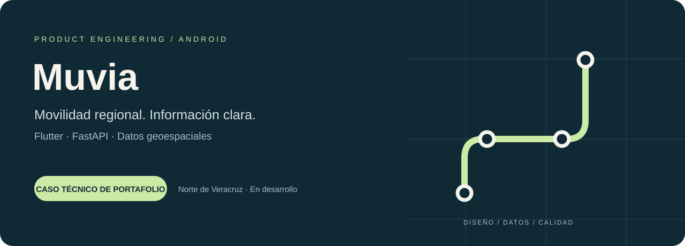
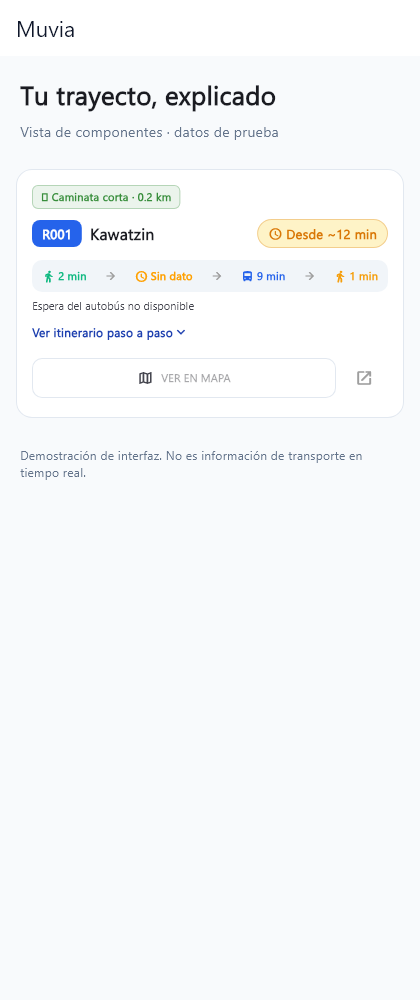
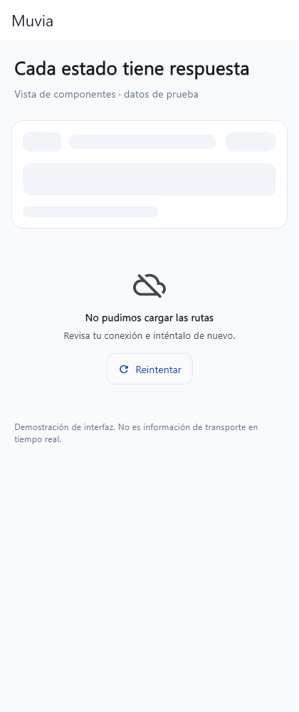

<b>Flutter · Dart · FastAPI · PostgreSQL / PostGIS</b> Proyecto de portafolio · Android · Norte de Veracruz

## Una app de movilidad que explica sus límites

Muvia explora cómo consultar líneas, comparar recorridos directos y entender un trayecto de transporte público en una región concreta. El foco inicial es Poza Rica y Coatzintla; Papantla y Tihuatlán forman parte de la expansión prevista.

El reto técnico está en transformar datos geográficos incompletos en una experiencia útil: distinguir un cálculo de una posición real, respetar el sentido del recorrido y comunicar cuando falta información.

**Estado:** prototipo funcional con APK Android de pruebas. Aún no está publicado en Play Store. La información de transporte utilizada es demostrativa; no constituye un servicio de navegación operativo.

Este repositorio presenta el producto y el trabajo de ingeniería. El código de la aplicación y del backend se mantiene privado.

## Vista del producto

  
  &nbsp;
  

Capturas de los componentes reales renderizados con Flutter en un entorno controlado. Los datos proceden de ejemplos de pruebas; las imágenes no son capturas de viajes reales ni acreditan cobertura. [Contexto de las capturas](docs/product.md).

## Experiencia implementada

- Consulta de líneas, variantes y paradas, con selección sobre mapa.
- Planificación de trayectos directos y desglose de caminata y recorrido.
- Comparación de alternativas sin declarar una opción más rápida cuando falta información temporal suficiente.
- Etiquetas de procedencia para estimaciones y unidades simuladas.
- Favoritos e historial locales, tema claro/oscuro y estados de carga y error.

## Trabajo de ingeniería

La evolución parte de un prototipo previo. El trabajo documentado en esta etapa se concentra en contratos de datos, separación de servicios, pruebas de regresión y configuración de despliegue.

| Decisión | Qué resuelve |
|---|---|
| Proveedores inyectables de catálogo y posiciones | Cambiar la fuente de datos sin acoplarla a las pantallas |
| Procedencia explícita de datos | Evitar presentar simulación como telemetría real |
| Recorridos lineales por defecto | No asumir que una ruta permite volver al inicio |
| Espera desconocida expresada como límite inferior | Mostrar la incertidumbre en lugar de inventar minutos |
| Pruebas de unidades, servicios y widgets | Detectar regresiones en cálculo, parsing y estados |
| Guardas por entorno | Rechazar configuraciones demo inseguras al desplegar |

[Arquitectura](docs/architecture.md) · [Validación y límites](docs/quality.md) · [Caso de producto](docs/product.md)

## Evidencia técnica

Última validación local documentada: **26 de septiembre de 2026**.

| Comprobación | Resultado |
|---|---|
| Análisis Flutter | Sin incidencias |
| Suite Flutter | 157 pruebas aprobadas |
| Suite backend aislada | 104 pruebas aprobadas |
| Compilación Android | APK debug generada |
| Integración PostGIS | Pendiente de instancia de pruebas; 3 pruebas excluidas |

Son resultados locales, no un sello de disponibilidad en producción. Los tests aislados del backend emplean sustitutos espaciales y no reemplazan una validación con PostGIS real. Las capturas se generan por separado de estas cifras.

## Siguiente etapa

Validar recorridos y paradas con fuentes regionales, probar el flujo en dispositivos y conectar una instancia PostGIS de pruebas. Antes de publicar en Play Store quedan pendientes firma de distribución, privacidad, despliegue y revisión del comportamiento en campo.

No se prometen transbordos, horarios oficiales ni seguimiento GPS de unidades mientras no exista una fuente que los sustente.

## Contacto

Perfil profesional: [victorhdays](https://github.com/victorhdays). La revisión técnica puede realizarse mediante una demostración acordada, sin distribuir públicamente el código.

[Alcance de uso y atribuciones](NOTICE.md)
