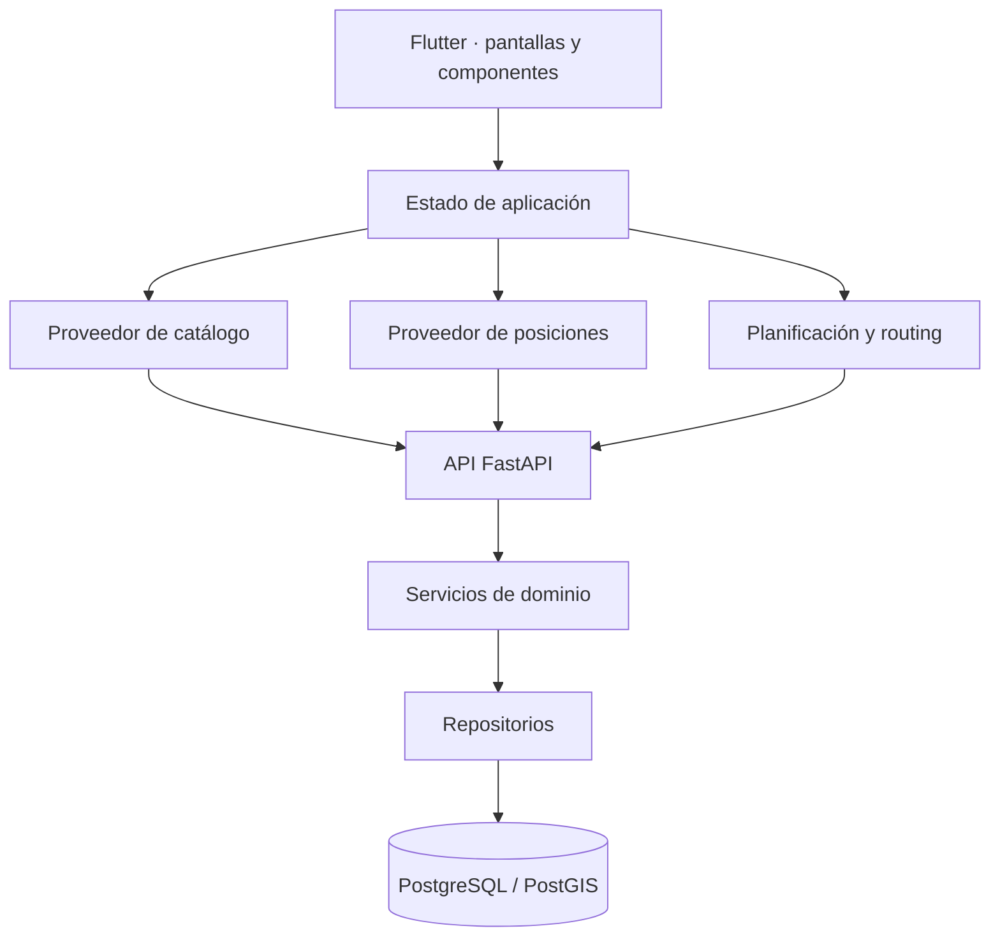

# Arquitectura

La solución está organizada como una aplicación Flutter y una API de dominio respaldada por PostgreSQL/PostGIS. El repositorio público explica las responsabilidades; los contratos completos y la implementación permanecen en el proyecto privado.

## Fronteras actuales

**Interfaz y estado.** Flutter gestiona selección de línea, planificador, estados de carga y preferencias locales. Los componentes consumen modelos tipados.

**Catálogo y posiciones.** Dos contratos inyectables separan la fuente HTTP del estado de pantalla. Las posiciones conservan su procedencia; el proveedor actual devuelve datos de simulación.

**Backend.** FastAPI expone consultas de líneas, paradas, planificación y estimaciones. Servicios y repositorios mantienen separadas las reglas de recorrido y el acceso a la base de datos.

**Datos espaciales.** Geometrías, paradas y secuencias sustentan el cálculo de recorridos directos. La caminata del planificador se aproxima mediante distancia geodésica; no representa necesariamente un camino transitable por calles.

## Decisiones y compromisos

- Se conserva planificación directa. Añadir un grafo de transbordos exige conexiones y tiempos que todavía no están verificados.
- La extracción de proveedores es gradual. Planificación, alertas y algunos flujos conservan lógica pendiente de refactor.
- Los datos incompletos se reflejan en el resultado. La ausencia de una llegada conocida no equivale a espera cero.
- Existe un control explícito del sentido de los recorridos. La simulación de retornos y la clasificación por variante requieren validación adicional.

## Evolución prevista

La siguiente frontera es incorporar fuentes operativas versionadas y fechas de actualización. Una futura integración GPS necesitaría ingesta autorizada, timestamps, detección de posiciones caducadas y evaluación de calidad. Ese servicio no está implementado ni se simula como capacidad productiva.
